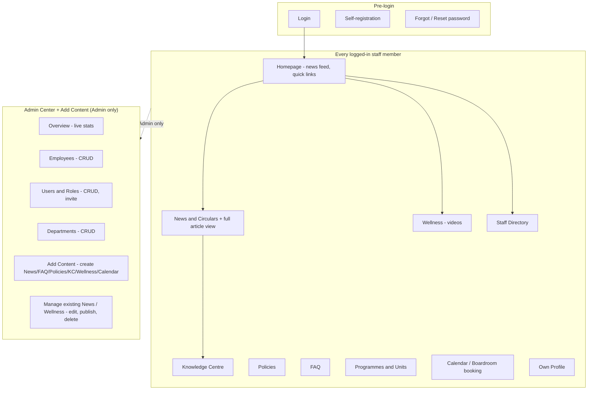

# Project Overview

## 1. What this is

The DEDaT Intranet is an internal staff portal for the **Northern Cape
Department of Economic Development and Tourism** (DEDaT), a South
African provincial government department. It's a private, login-required
web application — not a public website — intended to be the department's
single internal hub for news, policies, staff information, and
day-to-day administrative content.

## 2. Problems it solves

- **Scattered internal communication.** Department news, circulars, and
  policy documents previously had no single, searchable, department-wide
  home.
- **No self-service staff directory.** Finding who works where, what
  their skills are, or who to contact in a given programme required
  asking around.
- **Content publishing required developer involvement.** Before this
  engagement, there was no real Admin role — anyone logged in could
  technically reach the content-publishing screen, and there was no
  proper way for non-technical staff to manage employees, departments, or
  user accounts without someone editing the database directly.
- **Wellness resources were hard to find and some were simply broken** —
  uploaded videos didn't actually work for anyone but the uploader.

## 3. Intended users

Department staff whose email ends in `@ncdedat.gov.za`, split into two
roles:

| Role | Who | What for |
|---|---|---|
| **Employee** | Every staff member who registers (must already exist as an `employees` record) | Browsing news, policies, the knowledge centre, wellness content, the staff directory, booking the boardroom/meeting rooms, managing their own profile |
| **Admin** | A small number of trusted staff (currently one: `ungomane@ncdedat.gov.za`) | Everything an Employee can do, plus publishing/editing/deleting all content, managing employee records, managing user accounts and roles, managing departments |

There is no public-facing (logged-out) functionality beyond the login,
self-registration, and password-reset screens.

## 4. Core business workflows

1. **Staff onboarding:** an employee record must exist (seeded from an
   HR-provided list) before someone can self-register an account against
   their government email.
2. **Content publishing:** an Admin creates News, Circulars, FAQs,
   Policies, Knowledge Centre resources, or Wellness videos through
   **Add Content**, optionally as a Draft before making it visible to
   everyone.
3. **Reading content:** any logged-in staff member browses or searches
   published content, and can read a News article in full (not just a
   preview).
4. **Staff directory lookups:** any logged-in staff member searches the
   employee directory by name, department, skill, or mentor availability.
5. **Room booking:** any logged-in staff member books a calendar slot;
   boardroom bookings are checked for overlap.
6. **Administration:** an Admin manages employee records, departments,
   and user accounts/roles — all changes persist to PostgreSQL and are
   visible immediately.

## 5. Feature map

## 6. System boundaries

- **In scope:** everything described above, running as a single React
  SPA + single Express API + single PostgreSQL database.
- **Explicitly out of scope / not implemented:** leave management and
  approvals, formal reports/analytics beyond the Admin stats panel, any
  external HR/payroll system integration, SMS or push notifications, SSO.
  Several of these appear as static, non-functional UI elements on the
  Dashboard page (see [`PROJECT_STATUS.md`](PROJECT_STATUS.md)) —
  decorative placeholders carried over from an earlier design mockup, not
  working features.

## 7. Current implementation status (summary)

Authentication, RBAC, Employee/Department/User management, and the
News/Wellness/date-handling fixes described throughout this handover are
**fully implemented and verified** (see
[`PROJECT_STATUS.md`](PROJECT_STATUS.md) for the complete, itemized
breakdown with verification evidence). This overview describes the
system as it exists today, not an aspirational target.
