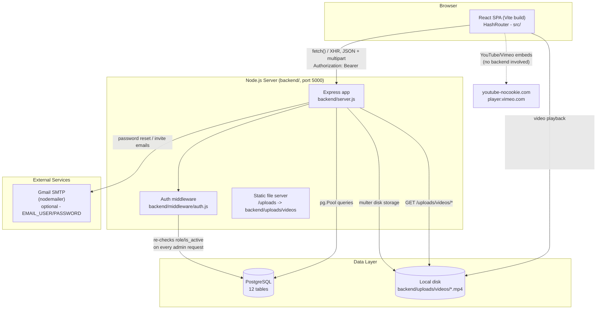
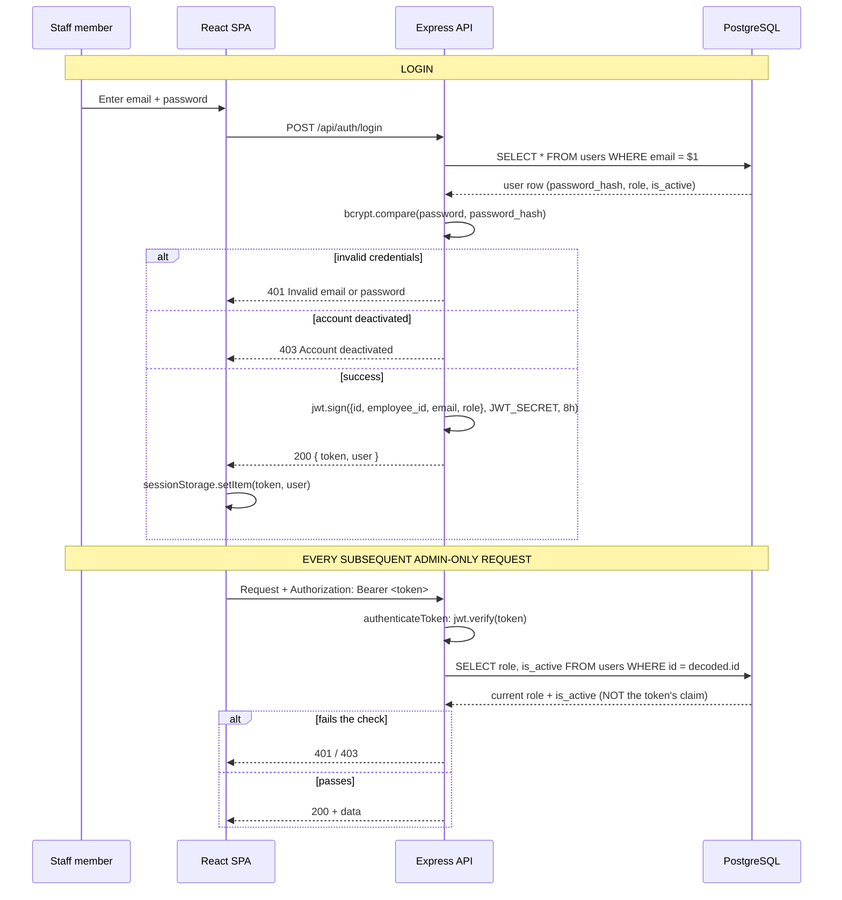
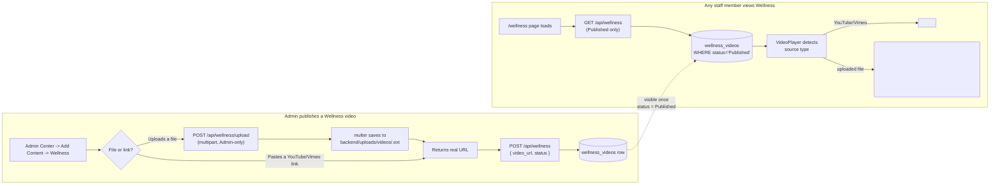

# System Architecture

## 1. Overall architecture

**In plain language:** this is a classic three-tier web application — a
single-page React app in the browser, a single Node/Express API server,
and a single PostgreSQL database — with two small additions: the backend
also serves uploaded video files directly off its own disk, and it can
send email through Gmail for password resets. There is no message queue,
no cache layer, no microservices, and no separate authentication service
— everything runs as two processes (frontend dev server or static build;
backend Node process) talking to one database.

## 2. Frontend ↔ backend communication

Every request from the browser is a plain `fetch()` call (or, for file
uploads, `XMLHttpRequest` — chosen specifically so upload progress can be
reported) to `http://localhost:5000/api/...` in development. There is no
GraphQL, no WebSocket, no server-sent events — pure request/response
REST-ish JSON over HTTP, with one multipart exception for video uploads.
`src/services/apiClient.js`'s `authFetch()` is the one place the
`Authorization: Bearer <token>` header gets attached, so every service
file downstream of it doesn't repeat that logic.

CORS is wide open (`app.use(cors())` with no origin restriction) — fine
for a same-network internal tool in its current deployment shape, but
worth tightening if the API is ever exposed to the public internet
directly (see `guides/DEPLOYMENT_GUIDE.md`).

## 3. Authentication & authorization flow

**In plain language:** logging in gets you a signed token good for 8
hours, stored only in that browser tab. The important design decision is
in the second half of the diagram: the backend **never trusts the role
written inside that token** for permission decisions — on every
admin-only request it goes back to the database and checks what your
role actually is *right now*. That's what makes it safe for an Admin to
demote or deactivate someone and have it take effect immediately, instead
of up to 8 hours later. Full detail, including why this matters and how
it's tested, is in
[`../technical/AUTHENTICATION_AND_RBAC.md`](../technical/AUTHENTICATION_AND_RBAC.md).

## 4. Database communication

Every database access goes through one shared connection pool
(`backend/db.js`, a single `pg.Pool` instance) and raw, parameterized SQL
— there's no repository/DAO layer between a route handler and its query.
This keeps the data access fully visible at the point of use, at the cost
of some repetition (the same `SELECT *` shape is written out in each
route that needs it rather than shared through a model class). See
[`../technical/DATABASE_DOCUMENTATION.md`](../technical/DATABASE_DOCUMENTATION.md)
for the full schema and the ERD.

## 5. A representative business workflow: publishing a Wellness video

**In plain language:** this traces exactly how a video file an Admin
uploads actually ends up playable for everyone — the part of the system
that was broken before this engagement (uploads previously saved a
browser-local `blob:` link that only worked in the uploader's own tab;
see
[`../NEWS_WELLNESS_GUIDE.md`](../NEWS_WELLNESS_GUIDE.md)). The same
Draft/Published gate shown here applies identically to News articles.

## 6. File & media storage architecture

Uploaded video files live on the backend server's **local disk**
(`backend/uploads/videos/`), served back out by Express's built-in static
file middleware. There is no object storage service involved. This is
the single architectural point most relevant to any future deployment
decision: it assumes exactly one backend instance with persistent local
disk. See
[`../technical/INTEGRATIONS.md`](../technical/INTEGRATIONS.md) and
[`../guides/DEPLOYMENT_GUIDE.md`](../guides/DEPLOYMENT_GUIDE.md).

## 7. Deployment architecture (as configured today)

No deployment has actually been performed as part of this engagement —
everything described in this handover was built and verified against
`localhost`. What **is** configured:

- Frontend: `npm run deploy` (via the `gh-pages` package) builds the
  Vite app and pushes `dist/` to a `gh-pages` branch — a static-hosting
  deployment path for the frontend only.
- Backend: no deployment configuration exists; it's a plain Node process
  (`node server.js`) that would need an always-on host (a VM, a
  platform-as-a-service, etc.) wired up separately — see
  [`../guides/DEPLOYMENT_GUIDE.md`](../guides/DEPLOYMENT_GUIDE.md) for
  what that requires and what isn't yet decided.
