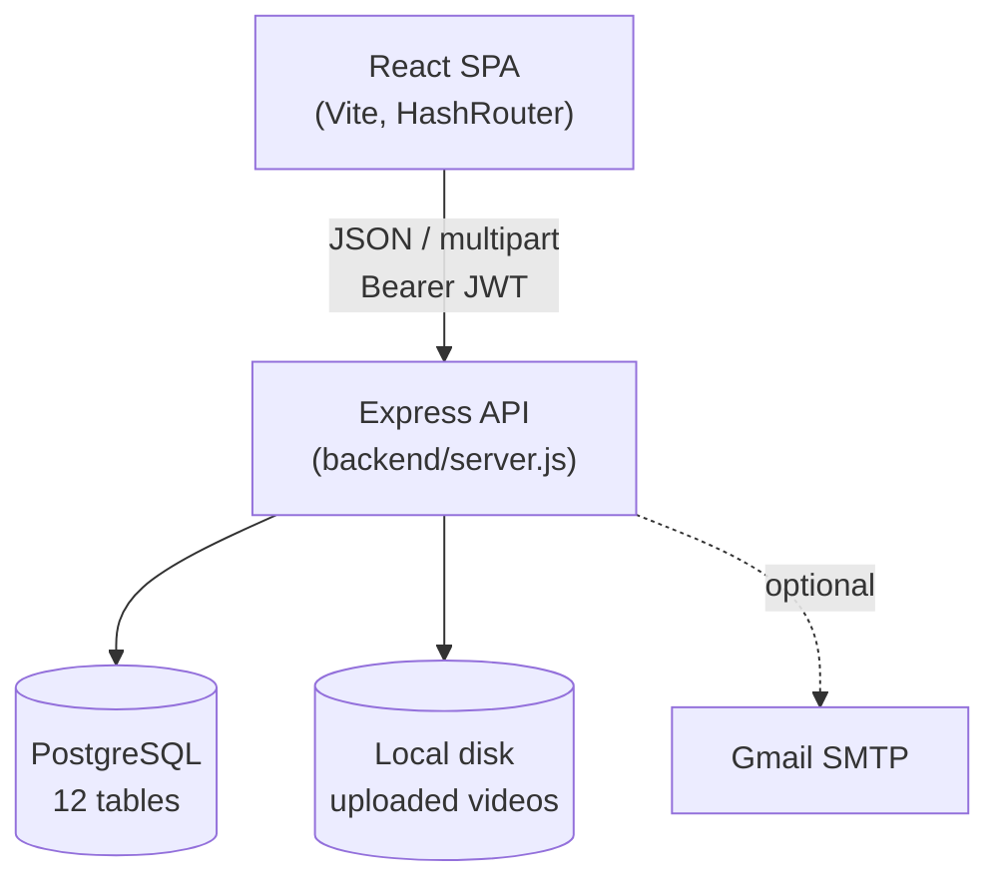
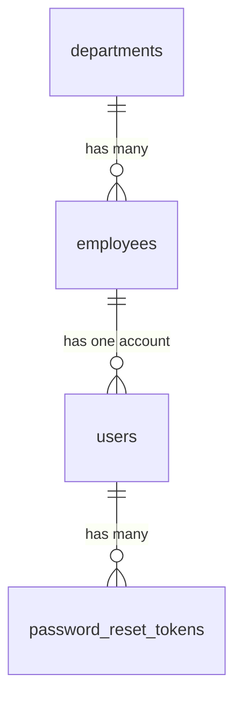

# DEDaT Intranet — Technical Handover

**Prepared:** November 2026
**Audience:** Incoming developers, IT administrators, and technical
stakeholders taking over or extending this system without the original
developer.

This document is the front door of the handover package. It's complete
enough to read standalone, and links out to a deeper reference for every
topic it summarizes — nothing here contradicts those deeper documents;
they're the same facts at more or less detail.

---

## Table of Contents

1. [Project Overview](#1-project-overview)
2. [System Architecture](#2-system-architecture)
3. [Technology Stack](#3-technology-stack)
4. [Codebase Structure](#4-codebase-structure)
5. [Database](#5-database)
6. [API Surface](#6-api-surface)
7. [Authentication & Authorization](#7-authentication--authorization)
8. [Application Modules](#8-application-modules)
9. [User Roles](#9-user-roles)
10. [Installation Summary](#10-installation-summary)
11. [Testing](#11-testing)
12. [Security Posture](#12-security-posture)
13. [Deployment](#13-deployment)
14. [Project Status](#14-project-status)
15. [Document Index](#15-document-index)

---

## 1. Project Overview

The DEDaT Intranet is a private, login-required web application for the
Northern Cape Department of Economic Development and Tourism — a staff
portal for internal news, policies, the employee directory, wellness
content, and day-to-day administration. It replaces no prior system (per
the information available in this codebase); it's the department's first
centralized internal portal.

Two user roles exist: **Employee** (every registered staff member) and
**Admin** (currently one account, `ungomane@ncdedat.gov.za`), who can
additionally manage all content, employees, departments, and user
accounts.

Full detail: [`PROJECT_OVERVIEW.md`](PROJECT_OVERVIEW.md)

## 2. System Architecture

A standard three-tier web application — React SPA, Express API,
PostgreSQL database — with two additions: the backend serves
Admin-uploaded video files directly from local disk, and can send email
via Gmail SMTP for password resets.



No message queue, cache layer, or microservices. Every database access is
raw parameterized SQL through one connection pool — no ORM.

Full detail with the authentication-flow and data-flow diagrams:
[`SYSTEM_ARCHITECTURE.md`](SYSTEM_ARCHITECTURE.md)

## 3. Technology Stack

| Layer | Technology |
|---|---|
| Frontend | React 19.2.7, Vite 8.1.1, react-router-dom 7.18.1 |
| Rich text | Tiptap 3.33.0 + tiptap-markdown 0.9.0 |
| Backend | Node.js, Express 5.2.1 |
| Database | PostgreSQL (18.6 in development), accessed via `pg` 8.23.0 |
| Auth | jsonwebtoken 9.0.3, bcryptjs 3.0.3 |
| File uploads | multer 2.5.0 |
| Email | nodemailer 10.0.10 (Gmail SMTP) |
| Testing | Jest 29.7 + Supertest 7.3.2 (backend, 38 tests); Vitest 5.1 + Testing Library (frontend, 51 tests) |

No CI/CD pipeline and no containerization (Docker) are configured in this
repository. Full detail with every dependency's purpose:
[`TECHNOLOGY_STACK.md`](TECHNOLOGY_STACK.md)

## 4. Codebase Structure

```
backend/        Express API (port 5000). server.js holds every route -
                 not split into controllers/services files.
src/             React frontend.
  pages/           One file per route (three are thin wrappers around a
                   same-named folder under components/ - see below).
  components/      Shared UI + the three pages' real implementations.
  services/        Every fetch()/XHR call in the app lives here.
  routes/          ProtectedRoute / AdminRoute guards.
docs/            This documentation package.
server.js        LEGACY, unused (a separate, earlier app on port 3001).
```

**Wrapper pattern:** `pages/Homepage.jsx`, `pages/NewsCirculus.jsx`, and
`pages/StaffDirectory.jsx` are two-line wrappers; their real
implementations live in `components/home/home.jsx`,
`components/news/newspage_Component.jsx`, and
`components/staff/staffDirectoryComponent.jsx` respectively.

**8 confirmed dead files** exist (unused components + one unused data
file) — listed with the rest of the navigation guide in
[`PROJECT_STRUCTURE.md`](PROJECT_STRUCTURE.md), which also has a
task-based "I need to change X → go to Y" lookup table.

## 5. Database

12 tables, 3 real foreign-key relationships
(`users.employee_id→employees.id`, `employees.department_id→departments.id`,
`password_reset_tokens.user_id→users.id`). The seven content tables
(news, circulus, wellness_videos, documents, policies, faqs,
calendar_events) are standalone — `author`/`knowledge_owner` are free
text, not references to a person record.



Six migrations have been applied, in order, adding: the `schema_migrations`
tracking table itself, RBAC fields on `users`, profile fields on
`employees`, the `departments` table, `password_reset_tokens`, and the
Draft/Published `status` workflow on `news`/`wellness_videos`.

Full column-level documentation, the complete ERD, and Windows
PowerShell backup/restore commands:
[`../technical/DATABASE_DOCUMENTATION.md`](../technical/DATABASE_DOCUMENTATION.md)

## 6. API Surface

52 endpoints under `/api/*`, grouped by resource: auth (4), news (5),
wellness (6), calendar-events (2), documents (5), policies (5), faqs (4),
circulus (4), employees (7), departments (4), users/admin (8 across
profile + admin user management), plus one legacy public endpoint and one
admin stats endpoint. Every endpoint, its required auth level, and
example requests/responses are in
[`../technical/API_DOCUMENTATION.md`](../technical/API_DOCUMENTATION.md).

## 7. Authentication & Authorization

JWT-based, 8-hour tokens, stored in `sessionStorage` (not cookies). The
critical design point: **the backend never trusts the role embedded in a
token** — every Admin-gated request re-queries the user's current
`role`/`is_active` from PostgreSQL, so a role change or deactivation
takes effect on the very next request rather than waiting out the
token's lifetime. This is directly tested
(`backend/tests/middleware.auth.test.js`).

Frontend route guards (`ProtectedRoute`/`AdminRoute`) are UX convenience
only, not the security boundary — every endpoint they gate independently
enforces the same rule server-side.

Full detail, including the role-permission matrix and every
account-creation path: [`../technical/AUTHENTICATION_AND_RBAC.md`](../technical/AUTHENTICATION_AND_RBAC.md)

## 8. Application Modules

| Module | Who | Status |
|---|---|---|
| Login / self-registration / password reset | Everyone | Verified working |
| Homepage (news feed, quick links) | Logged in | Verified working |
| News & Circulars + full article reading | Logged in (publish: Admin) | Verified working |
| Wellness (videos) | Logged in (publish: Admin) | Verified working |
| Knowledge Centre, Policies, FAQ | Logged in (publish: Admin) | Implemented, lighter test coverage |
| Staff Directory | Logged in | Verified working, DB-backed |
| Programmes & Units | Logged in (manage: Admin, via Departments) | Verified working, DB-backed |
| Calendar / boardroom booking | Logged in | Implemented, lighter test coverage |
| Profile (own account) | Logged in | Verified working |
| Admin Center: Employees, Users & Roles, Departments, Overview stats | Admin | Verified working |
| Dashboard | Logged in | **Partially implemented** — mostly static/decorative; see §14 |

Full per-module detail (screens, workflows, backend endpoints, database
tables) is woven through
[`PROJECT_OVERVIEW.md`](PROJECT_OVERVIEW.md),
[`../technical/API_DOCUMENTATION.md`](../technical/API_DOCUMENTATION.md),
and the module-specific guides
([`../ADMIN_GUIDE.md`](../ADMIN_GUIDE.md),
[`../NEWS_WELLNESS_GUIDE.md`](../NEWS_WELLNESS_GUIDE.md)).

## 9. User Roles

| | Employee | Admin |
|---|---|---|
| Read all published content, directory, departments | Yes | Yes |
| Book calendar / boardroom | Yes | Yes |
| Publish/edit/delete content, see Drafts | No | Yes |
| Manage employees, departments, user accounts/roles | No | Yes |

The full, code-verified permission matrix is in
[`../technical/AUTHENTICATION_AND_RBAC.md`](../technical/AUTHENTICATION_AND_RBAC.md) §5.

## 10. Installation Summary

```bash
npm install && cd backend && npm install && cd ..
cp .env.example .env && cp backend/.env.example backend/.env   # then edit backend/.env
psql -U postgres -d dedat_intranet -f backend/database/schema.sql
cd backend
npm run migrate
npm run import:employees
npm run migrate:employee-profiles
npm run provision:admin -- ungomane@ncdedat.gov.za
npm start                 # terminal 1, from backend/
npm run dev                # terminal 2, from repo root
```

Full step-by-step guide with Windows-specific detail (PostgreSQL PATH,
service verification) and a troubleshooting section:
[`../guides/INSTALLATION_GUIDE.md`](../guides/INSTALLATION_GUIDE.md)

## 11. Testing

```bash
cd backend && npm test   # Jest + Supertest - 38 tests, 4 files
npm test                 # Vitest - 51 tests, 7 files (from repo root)
```

Coverage includes RBAC enforcement (including a test that proves a stale
JWT role claim is ignored in favor of the live database value), the
Draft/Published workflow, video upload validation, date-formatting edge
cases (including the specific timezone-shift bug class this engagement
fixed), and the Admin UI's route guards. Full breakdown, including what's
**not** covered, in
[`../support/TESTING_GUIDE.md`](../support/TESTING_GUIDE.md).

## 12. Security Posture

**Verified in place:**

- Passwords: bcrypt-hashed, never returned by any API response.
- SQL injection: every query is parameterized (`$1, $2...`) — no string
  concatenation found anywhere in `backend/server.js`.
- XSS: user-authored content (News bodies, FAQ answers) is rendered via
  `react-markdown`, which does not interpret raw HTML by default — no
  `dangerouslySetInnerHTML` is used for this content anywhere in the
  codebase.
- RBAC: enforced server-side, re-checked against the live database on
  every request (§7).
- File uploads: server-generates the filename (UUID, never the client's
  original name), MIME-type-filtered to `video/*` only, size-capped at
  200MB.
- Password reset: tokens are SHA-256 hashed at rest, single-use,
  time-limited; the forgot-password endpoint gives an identical response
  whether or not the email exists (prevents account enumeration).

**Not yet addressed** (see
[`PROJECT_STATUS.md`](PROJECT_STATUS.md) §7 for the full list):
unrestricted CORS, email delivery unconfigured in this environment, a
single point-of-failure Admin account, an unauthenticated legacy
`/api/users` endpoint exposing staff PII to anyone who finds the URL.

## 13. Deployment

No deployment has been performed — everything in this handover was
built and verified against `localhost`. A `gh-pages`-based static deploy
path exists for the **frontend only** (`npm run deploy`); the backend has
no deployment configuration and needs an always-on Node host. The
single biggest architectural fact to carry into any deployment decision:
uploaded video files live on local disk, which assumes one backend
instance — see
[`../guides/DEPLOYMENT_GUIDE.md`](../guides/DEPLOYMENT_GUIDE.md).

## 14. Project Status

Authentication, RBAC, Admin Center (Employees/Departments/Users),
News/Wellness (including the Draft workflow, full-article reading, and
real video upload), and the centralized date-handling fix are **fully
implemented and verified**. The **Dashboard page is largely decorative**
— hardcoded data throughout, a hardcoded greeting name, and four Quick
Action buttons that don't do anything when clicked (confirmed by reading
the code: they have no `action` value wired up). 8 frontend files and one
legacy backend file are confirmed dead code. Full itemized status,
including everything partially implemented, every known bug, and a
prioritized improvement list: [`PROJECT_STATUS.md`](PROJECT_STATUS.md)

## 15. Document Index

| Document | Covers |
|---|---|
| [`PROJECT_OVERVIEW.md`](PROJECT_OVERVIEW.md) | Business purpose, users, workflows, feature map |
| [`PROJECT_STRUCTURE.md`](PROJECT_STRUCTURE.md) | Full file tree, navigation guide, dead code |
| [`SYSTEM_ARCHITECTURE.md`](SYSTEM_ARCHITECTURE.md) | Diagrams + explanation for every major flow |
| [`TECHNOLOGY_STACK.md`](TECHNOLOGY_STACK.md) | Every dependency, version, purpose |
| [`PROJECT_STATUS.md`](PROJECT_STATUS.md) | What's done, partial, broken, missing — prioritized |
| [`../technical/DATABASE_DOCUMENTATION.md`](../technical/DATABASE_DOCUMENTATION.md) | Full schema, ERD, backup/restore |
| [`../technical/API_DOCUMENTATION.md`](../technical/API_DOCUMENTATION.md) | All 52 endpoints with examples |
| [`../technical/AUTHENTICATION_AND_RBAC.md`](../technical/AUTHENTICATION_AND_RBAC.md) | Auth mechanics, permission matrix |
| [`../technical/FRONTEND_DOCUMENTATION.md`](../technical/FRONTEND_DOCUMENTATION.md) | Frontend architecture + task lookup |
| [`../technical/BACKEND_DOCUMENTATION.md`](../technical/BACKEND_DOCUMENTATION.md) | Backend architecture + scripts |
| [`../technical/INTEGRATIONS.md`](../technical/INTEGRATIONS.md) | Email, storage, video embeds — and what's NOT integrated |
| [`../guides/INSTALLATION_GUIDE.md`](../guides/INSTALLATION_GUIDE.md) | Full setup from a blank machine |
| [`../guides/DEVELOPER_GUIDE.md`](../guides/DEVELOPER_GUIDE.md) | Conventions, how to extend the system |
| [`../guides/ADMIN_USER_GUIDE.md`](../guides/ADMIN_USER_GUIDE.md) | How Admins manage the system |
| [`../guides/END_USER_GUIDE.md`](../guides/END_USER_GUIDE.md) | How staff use the application |
| [`../guides/DEPLOYMENT_GUIDE.md`](../guides/DEPLOYMENT_GUIDE.md) | What's needed to actually deploy this |
| [`../guides/MAINTENANCE_GUIDE.md`](../guides/MAINTENANCE_GUIDE.md) | Ongoing operational tasks |
| [`../support/TROUBLESHOOTING.md`](../support/TROUBLESHOOTING.md) | Common problems and fixes |
| [`../support/TESTING_GUIDE.md`](../support/TESTING_GUIDE.md) | Running and understanding the test suites |
| [`../support/BACKUP_AND_RECOVERY.md`](../support/BACKUP_AND_RECOVERY.md) | Database backup/restore procedures |
| [`../support/KNOWN_ISSUES.md`](../support/KNOWN_ISSUES.md) | Every known bug, prioritized |
| [`../HANDOVER_CHECKLIST.md`](../handover/HANDOVER_CHECKLIST.md) | Sign-off checklist for this handover |
| [`../ADMIN_GUIDE.md`](../ADMIN_GUIDE.md) | Narrative: how the Admin account was configured |
| [`../NEWS_WELLNESS_GUIDE.md`](../NEWS_WELLNESS_GUIDE.md) | Narrative: the News/Wellness/date fixes in detail |
| [`../USER_FLOW_AND_ADMIN.md`](../USER_FLOW_AND_ADMIN.md) | Original route/endpoint walkthrough |
| [`../SETUP_AND_CHANGES.md`](../SETUP_AND_CHANGES.md) | Quick-start + what changed, written for someone pulling the repo fresh |
