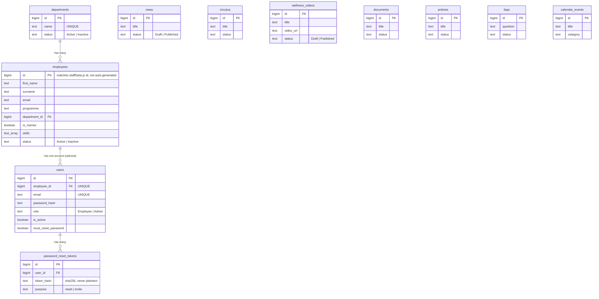

# Database Documentation

Verified directly against a running instance (`psql`/`information_schema`
queries), not inferred from the SQL files alone — this reflects the
database as it actually exists after all six migrations are applied.

- **Engine:** PostgreSQL
- **Version used in development:** 18.6 (any reasonably recent PostgreSQL
  should work; nothing here uses version-specific features beyond
  standard SQL, `CHECK` constraints, and `BIGSERIAL`)
- **Database name (local dev):** `dedat_intranet` (whatever you name it
  when you create it — not hardcoded anywhere except `backend/.env`)
- **Driver:** [`pg`](https://node-postgres.com/) (`node-postgres`), used
  directly with parameterized SQL — no ORM
- **Schema definition:** `backend/database/schema.sql` (base tables) +
  `backend/database/migrations/*.sql` (everything added since)

## 1. Entity-Relationship Diagram



The full version with every column is in
[`../diagrams/DATABASE_ERD.mmd`](../diagrams/DATABASE_ERD.mmd).

**Only three real foreign-key relationships exist in this schema** —
verified via `information_schema`, not assumed:

| From | Column | To | Meaning |
|---|---|---|---|
| `users` | `employee_id` | `employees.id` | Each account belongs to exactly one employee (`UNIQUE` constraint — one account per employee) |
| `employees` | `department_id` | `departments.id` | `ON DELETE SET NULL` — deactivating a department never deletes its employees |
| `password_reset_tokens` | `user_id` | `users.id` | `ON DELETE CASCADE` |

The content tables (`news`, `circulus`, `wellness_videos`, `documents`,
`policies`, `faqs`, `calendar_events`) are **standalone** — none of them
reference `users` or `employees` with a real foreign key. `author` and
`knowledge_owner` are free-text columns, not references to a person
record. This is a known limitation — see
[`../support/KNOWN_ISSUES.md`](../support/KNOWN_ISSUES.md).

## 2. Tables (as they exist today)

### `employees` — the 159-person staff directory

The record of who works at the department, independent of whether they
have a login. Seeded once from `src/components/staff/staffData.js` via
`backend/importEmployees.js`, then enriched (skills, mentor flag, phone,
location, experience) by `backend/scripts/migrateEmployeeProfiles.js`.
**`id` is not auto-generated** — it's supplied explicitly (matching the
source data's ids), which is why `POST /api/employees` requires an `id`
in the request body.

| Column | Type | Null? | Default | Notes |
|---|---|---|---|---|
| `id` | bigint | NO | — | Primary key, caller-supplied |
| `first_name`, `surname` | text | NO | — | |
| `full_name` | text | YES | — | Backfilled `first_name + ' ' + surname` |
| `initials` | text | YES | — | |
| `email` | text | YES | — | Not unique at the DB level |
| `phone`, `location` | text | YES | — | |
| `programme`, `subprogramme`, `position` | text | YES | — | Free text — `programme` is the pre-existing field; `department_id` is the newer, structured FK |
| `department_id` | bigint | YES | — | FK → `departments.id` |
| `is_mentor` | boolean | NO | `false` | |
| `skills` | text[] | NO | `{}` | Postgres array column |
| `experience` | text | YES | — | Free text, e.g. `"6 years"` |
| `status` | text | NO | `'Active'` | `CHECK (status IN ('Active','Inactive'))` |
| `created_date`, `updated_at` | timestamptz | NO | `now()` | |

### `users` — login accounts

One row per person who can log in. Not every employee has one.

| Column | Type | Null? | Default | Notes |
|---|---|---|---|---|
| `id` | bigserial | NO | — | |
| `employee_id` | bigint | NO | — | FK, `UNIQUE` |
| `first_name`, `surname`, `email` | text | NO | — | `email` `UNIQUE` |
| `programme`, `subprogramme`, `position` | text | YES | — | Copied from `employees` at register/update time, not live-joined |
| `password_hash` | text | NO | — | bcrypt, 10 rounds — never returned by any API response |
| `role` | text | NO | `'Employee'` | `CHECK (role IN ('Employee','Admin'))` |
| `is_active` | boolean | NO | `true` | `false` → login rejected with 403 |
| `must_reset_password` | boolean | NO | `false` | `true` for Admin-invited accounts until they set their own password |
| `last_login_at` | timestamptz | YES | — | Updated on every successful login |
| `created_date`, `updated_at` | timestamptz | NO | `now()` | |

### `departments`

| Column | Type | Null? | Default |
|---|---|---|---|
| `id` | bigserial | NO | — |
| `name` | text | NO | — (`UNIQUE`) |
| `description` | text | YES | — |
| `status` | text | NO | `'Active'` (`CHECK IN ('Active','Inactive')`) |
| `created_at`, `updated_at` | timestamptz | NO | `now()` |

Seeded once from the distinct `programme` values already present on
`employees` (migration `004_departments.sql`); managed going forward
through Admin Center → Departments.

### `password_reset_tokens`

Backs both the forgot-password flow and Admin-issued account invites.

| Column | Type | Null? | Default | Notes |
|---|---|---|---|---|
| `id` | bigserial | NO | — | |
| `user_id` | bigint | NO | — | FK, cascade delete |
| `token_hash` | text | NO | — | SHA-256 of the token sent to the user — the plaintext token is never stored |
| `purpose` | text | NO | `'reset'` | `CHECK IN ('reset','invite')` |
| `expires_at` | timestamptz | NO | — | 2h for resets, 48h for invites |
| `used_at` | timestamptz | YES | — | Set on first use; a used or expired token is rejected |
| `created_at` | timestamptz | NO | `now()` | |

### Content tables

All seven follow the same shape: a `status` column gating public
visibility (`'Published'`/`'Draft'` on `news`/`wellness_videos`; a
looser, pre-existing `status` string on the others that isn't yet
enforced the same way — see Known Issues), timestamps, and free-text
metadata. Exact columns:

| Table | Key columns beyond id/status/timestamps |
|---|---|
| `news` | `title`, `excerpt`, `content_markdown`, `category`, `author`, `publication_date` (date), `image_url`, `is_featured` (bool) |
| `circulus` | `title`, `description`, `category`, `author`, `publication_date` (date), `file_url` |
| `wellness_videos` | `title`, `description`, `category`, `duration`, `thumbnail`, `video_url`, `featured` (bool) |
| `documents` | `title`, `description`, `category`, `keywords`, `knowledge_owner`, `publication_date`, `review_date`, `version_number`, `file_url` |
| `policies` | `title`, `policy_number`, `description`, `category`, `author`, `publication_date`, `review_date`, `file_url` |
| `faqs` | `question`, `answer`, `category`, `keywords` |
| `calendar_events` | `title`, `description`, `start_time`/`end_time` (timestamptz), `category`, `quarter` — no `status` column (there's no draft concept for calendar events) |

### `schema_migrations`

Tracks which migration files have run (`version` = filename, e.g.
`006_news_wellness_publishing.sql`). Written to automatically by
`backend/scripts/migrate.js` — never edit it by hand.

## 3. Migrations (in order)

| File | What it adds |
|---|---|
| `001_schema_migrations.sql` | The tracking table itself |
| `002_users_rbac_fields.sql` | `is_active`, `must_reset_password`, `last_login_at`, `updated_at` on `users`; the `role` `CHECK` constraint |
| `003_employees_profile_fields.sql` | `full_name`, `initials`, `phone`, `location`, `is_mentor`, `skills`, `experience`, `status`, `department_id`, `updated_at` on `employees`; backfills `full_name` |
| `004_departments.sql` | Creates `departments`; seeds it from distinct `employees.programme` values; links `employees.department_id` by name match |
| `005_password_reset_tokens.sql` | Creates `password_reset_tokens` |
| `006_news_wellness_publishing.sql` | `status` on `news` (defaulting existing rows to `'Published'`); `status` + `updated_at` on `wellness_videos` |

Every migration is idempotent (`IF NOT EXISTS` / guarded `DO $$` blocks
for constraints) and safe to re-run.

## 4. Setup, backup, and restore commands (Windows PowerShell)

### Create the database and apply everything

```powershell
# Create the database (one-time, from any psql session)
psql -U postgres -c "CREATE DATABASE dedat_intranet;"

# Base schema
psql -U postgres -d dedat_intranet -f backend\database\schema.sql

# All migrations (idempotent - safe to re-run)
cd backend
npm run migrate
```

### Seed employee data

```powershell
npm run import:employees              # loads the 159 records from staffData.js
npm run migrate:employee-profiles     # backfills skills/mentor/phone/etc.
```

### Back up

```powershell
# Full backup (schema + data), custom format (recommended - supports
# selective restore and is compressed)
pg_dump -U postgres -d dedat_intranet -F c -f dedat_intranet_backup.dump

# Plain-SQL backup (human-readable, larger)
pg_dump -U postgres -d dedat_intranet -f dedat_intranet_backup.sql
```

### Restore

```powershell
# From a custom-format dump, into a fresh database
psql -U postgres -c "CREATE DATABASE dedat_intranet_restored;"
pg_restore -U postgres -d dedat_intranet_restored dedat_intranet_backup.dump

# From a plain-SQL dump
psql -U postgres -d dedat_intranet_restored -f dedat_intranet_backup.sql
```

### Verify integrity after a restore

```powershell
psql -U postgres -d dedat_intranet -c "SELECT table_name FROM information_schema.tables WHERE table_schema='public' ORDER BY table_name;"
# Expect 12 tables: calendar_events, circulus, departments, documents,
# employees, faqs, news, password_reset_tokens, policies,
# schema_migrations, users, wellness_videos

psql -U postgres -d dedat_intranet -c "SELECT COUNT(*) FROM employees;"
# Expect 159 (or however many your organization has imported)

psql -U postgres -d dedat_intranet -c "SELECT email, role FROM users WHERE role = 'Admin';"
# Expect at least one row - if zero, re-run:
#   cd backend && npm run provision:admin -- ungomane@ncdedat.gov.za
```

No backup automation (scheduled jobs, retention policy) exists in this
project — see [`../guides/DEPLOYMENT_GUIDE.md`](../guides/DEPLOYMENT_GUIDE.md)
and [`../support/BACKUP_AND_RECOVERY.md`](../support/BACKUP_AND_RECOVERY.md).
